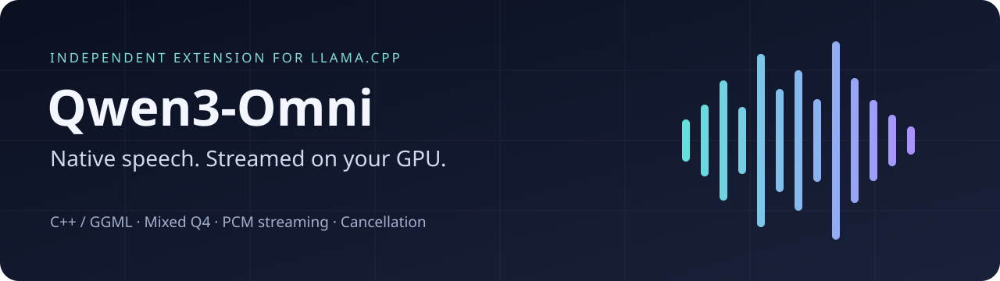

# Qwen3-Omni for llama.cpp — True Full Duplex

An independent C++/GGML extension for **Qwen3-Omni-30B-A3B-Instruct**: GPU Talker → Code Predictor → Code2Wav, mixed-Q4 Talker, immediate text deltas, incremental PCM, cancellation and memory-aware loading. **v0.2.0 adds concurrent Thinker input and GPU speech synthesis, with playback-confirmed dialogue state.**

**llama.cpp, its server and GGML are upstream projects, not our work.** This repository adds native Omni speech support to the pinned upstream source. Original upstream copyright and licenses remain intact. The original Omni additions are copyright 2026 Andrei Tolkachev, MIT licensed. Built with AI assistance and human-directed validation; not an official ggml-org or Qwen release.

[Русский](README.ru.md) · [Full-duplex API](tools/loraai_omni_native/DUPLEX.md) · [Build, weights and API](tools/loraai_omni_native/README.md) · [Native validation and timings](tools/loraai_omni_native/README.md#measurements-and-qualification) · [Licensing](LICENSING.md) · [Releases](https://github.com/andrei-tolkachev/qwen3-omni-llama-cpp-native/releases)

## Build

```sh
cmake -S . -B build-omni -DCMAKE_BUILD_TYPE=Release \
  -DBUILD_SHARED_LIBS=ON -DLLAMA_BUILD_SERVER=ON -DLLAMA_BUILD_TESTS=OFF \
  -DLLAMA_OMNI=ON -DGGML_CUDA=ON
cmake --build build-omni --target omni-server omni-generate omni-decode omni-quantize omni-duplex-test omni-voice-capture-test -j4
```

Obtain the matching Thinker/mmproj GGUF and convert the speech components following the [module instructions](tools/loraai_omni_native/README.md#weights). No model weights are distributed.

```sh
build-omni/bin/omni-server \
  -m /models/omni/thinker.gguf --mmproj /models/omni/mmproj.gguf \
  --host 127.0.0.1 --port 8081 -c 65536 -ngl auto --fit on --fit-target 1024
python3 tools/loraai_omni_native/scripts/voice_client.py --text 'Say hello briefly.'
```

The example client uses protocol-2 SSE, prints deltas immediately and plays PCM with `ffplay`. Ctrl-C stops playback and requests cancellation. [Curl, audio input and protocol details](tools/loraai_omni_native/README.md#run-and-stream).

## True Full Duplex

Thinker can process new text, PCM/WAV fragments and images **while Talker,
Code Predictor and Code2Wav continue synthesizing speech on GPU**. This is
concurrent native inference, not just recording a microphone while playing a
completed audio file.

```sh
OMNI_DUPLEX=1 OMNI_MEMORY_MODE=resident build-omni/bin/omni-server \
  -m /models/omni/thinker.gguf --mmproj /models/omni/mmproj.gguf \
  --host 127.0.0.1 --port 8081 -c 65536 -ngl auto --fit on
```

Open `/v1/omni/duplex` with `{"adaptive_dialogue":true,"messages":[]}` and keep
its SSE connection open. Send input and playback ACKs over separate HTTP
connections. The [protocol guide](tools/loraai_omni_native/DUPLEX.md) documents
all routes, events and lifecycle rules.

- Independent inference workers, GPU streams and mutable model state; one
  Thinker context and one speech lane per session.
- Playback ACKs append only completed, heard phrases to adaptive history.
  Cancellation discards unheard speech and recomputes dependent input.
- Speech-first VRAM admission, bounded queues, smaller phrases, synthesis pacing
  and exact Talker KV-prefix reuse without automatic precision reduction.
- Auxiliary Thinker queries, revision-checked context replacement, multimodal
  input and optional exact-text speech continuations.

The server supplies inference/session primitives. The caller supplies microphone
capture, echo cancellation, audio playback and semantic decisions about when to
yield or revise. Installing the upgrade kit alone does not install a conversational
agent or automatic turn-taking policy.

## Scope and known limits

- Historical GPU qualification: **Linux x86-64, CUDA, RTX 5090**. The adapter currently requires Linux ELF interposition; other GPUs/platforms are not qualified. The new native session API supports concurrent input and speech; microphone/audio-device integration remains client-side.
- Mixed-Q4 Talker is preferred automatically when its expected file exists. **BF16 stalled in CUDA expert multiplication on one input.** Passing that input with Q4 does not prove the BF16 defect fixed. Predictor and Code2Wav remain BF16.
- Historical single-request checks used 64,200 tokens in a 65,536-token context. Duplex measurements use short inputs in a 65K allocation; near-full concurrent multimodal context and 128K are not qualified.
- Phrase-grouped synthesis is in the native module. A **600.97-second segmented PCM test** passed, while a **separate 12-minute unsegmented run became unintelligible**. These results must be read together. ASR checks of a small Russian test set are not broad listening, English or multilingual qualification.
- Non-loopback binding requires an API key. All voice, cancel and duplex routes use upstream key validation. Remote deployments still need TLS and appropriate access controls. [Security](SECURITY_OMNI.md).
- One serial CUDA Xid 11 occurred during duplex development on driver 595.99.02; its cause remains unconfirmed. Later stress/sanitizer checks passed, but no fix is claimed. See [native duplex evidence](tools/loraai_omni_native/DUPLEX_VALIDATION.json).

See [VALIDATION.json](tools/loraai_omni_native/VALIDATION.json) for historical native evidence and [RELEASE_VALIDATION.json](RELEASE_VALIDATION.json) for release preparation checks.

## Source packages and updates

Releases provide a full source archive and a smaller **standalone upgrade kit**, with SHA-256 checksums and per-file manifests. The module in both archives is identical. The kit contains the native extension, conversion tools, numerical fixtures and one CUDA precision patch.

Base: [ggml-org/llama.cpp `86632248`](https://github.com/ggml-org/llama.cpp/commit/86632248188c106d749fad34a1dcd237c95863d4). Apply the kit to a fresh checkout with `scripts/apply_to_llama.py --check`, review compatibility changes, then rebuild and run the native regressions. Compatibility with arbitrary newer upstream revisions is not guaranteed. See [UPSTREAM.json](UPSTREAM.json).

```sh
python3 scripts/verify_source_manifest.py
```

For ordinary llama.cpp functionality, use the [original upstream documentation](https://github.com/ggml-org/llama.cpp/tree/86632248188c106d749fad34a1dcd237c95863d4). Its standard prebuilt binaries do not include this Omni extension.
